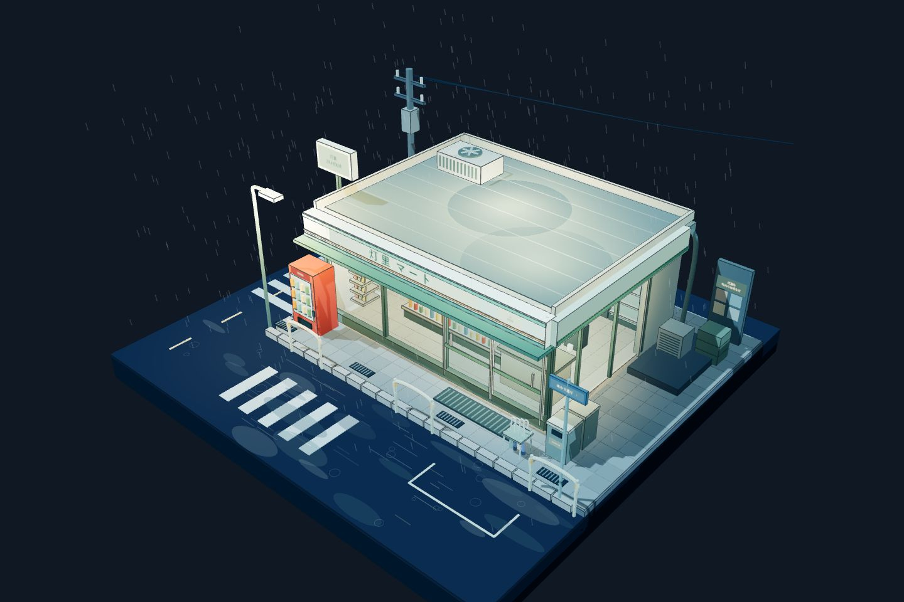

# 雨夜 · 灯里便利店

直接打开 index.html 即可观看，不需要联网，所有场景元素均为真正的三维几何体。

- 鼠标拖拽：旋转；滚轮：缩放。
- 右键拖拽或 Shift + 拖拽：平移。
- 触屏单指旋转，双指捏合缩放。
- 刷新页面重新播放约 7 秒的组装动画。

无人物、无界面按钮。完整正方形底座，暖光店内货架、饮料冷柜、收银台、热食柜、咖啡机、杂志架；室外包含贩卖机、自行车、伞架、垃圾桶、路灯、电线杆与悬线、路牌、护栏、车位、排水沟、斑马线、积水、小巷、空调外机和公告栏。

渲染使用 Three.js（MIT License）。支持现代桌面和移动浏览器，需要启用 WebGL。
